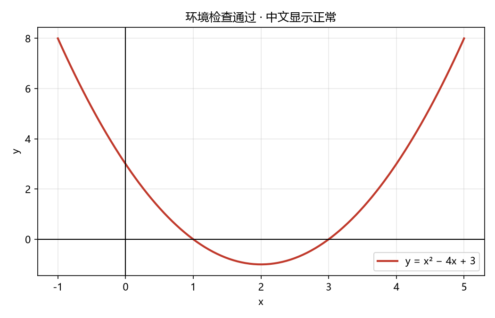

# python-learning

大一开始的 Python 学习与课程练习仓库。

课程：人工智能与 Python 程序设计（中南民族大学 · 化材 2601）

## 环境

- Python 3.13.15（`D:\Python313\python.exe`）
- 编辑器：VS Code + Python / Pylance / Jupyter 插件

安装依赖：

```bash
pip install -r requirements.txt
```

## 目录说明

| 文件 | 说明 |
|---|---|
| `01_环境检查.py` | 环境自检脚本，输出各库版本并生成一张中文图表 |

## 运行

在 VS Code 里打开文件，点右上角运行按钮；或在终端执行：

```bash
python 01_环境检查.py
```

## 进度记录

- 2026-11-06 搭建开发环境，跑通第一个脚本

## 环境自检结果


